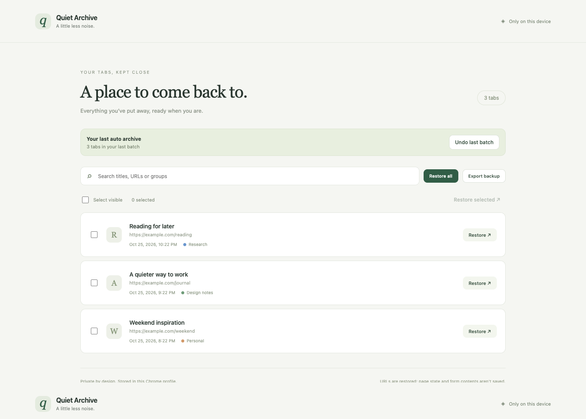

# Quiet Archive

A local-only Chrome extension inspired by Arc Auto Archive. Automatically close inactive tabs, keep chosen groups, and restore tabs from a private archive. TypeScript + Manifest V3, English interface, no account or server.



## Install in Chrome Developer Mode

Requires **Chrome 119+**. `tabs.lastAccessed` is used on Chrome 121+; earlier versions use conservative activity tracking.

### Ready-to-load build

1. Download and extract `quiet-archive-chrome.zip` from the repository's [Releases](../../releases).
2. Open `chrome://extensions` in the Chrome profile you want to use.
3. Enable **Developer mode** in the upper-right corner.
4. Click **Load unpacked** and select the extracted folder containing `manifest.json`.
5. Pin Quiet Archive in Chrome’s extensions menu and open its popup.

Each Chrome profile has its own settings and archive. Install separately in each profile. Incognito is intentionally disabled.

### Build from source

Use Node.js 22+ and npm:

```sh
npm ci
npm run check
```

Then load the repository’s **`dist/`** folder using the same Developer Mode steps. After changing the source, run `npm run build` and click Reload on the extension card. Keep the folder in a stable location so the unpacked extension keeps its identity and local data.

**After first installation or extension reload, existing loaded pages may need a normal page reload to gain the safety guard. Until then they are skipped.** The extension never reloads your pages itself.

## Use

- Select **24 hours**, **7 days**, **30 days**, or a custom whole-minute duration (1 minute to 365 days).
- Enable **Tabs playing audio** to protect audible tabs. Muted tabs are protected only if Chrome reports them as audible. Active, pinned and selected tabs in every window always stay open.
- Enable **Ungrouped tabs** to keep tabs outside any group. With it off, eligible ungrouped tabs are archived normally.
- Select groups under **Protected groups**. Rules persist even when the group or its window closes.
- **Open archive** to search titles, URLs and group names, restore one entry, select several, or restore everything.
- **Undo** in the popup/archive restores the most recent automatic batch still in the archive. Optional notifications provide an Undo button; if the OS hides it, use the popup.
- **Export backup** saves a JSON snapshot containing settings, titles and full URLs. Store it privately. This version exports backups for inspection/recovery; there is no backup-import UI.

Checks run approximately once a minute while Chrome runs, in batches of up to 50 successful closures. Sleep and browser scheduling can delay checks. The chosen interval means time since last activation, not a guarantee of closure at an exact instant. **Check tabs now** applies the same safety checks immediately. Settings save automatically, except a custom duration uses **Apply**.

## Safety and limits

Quiet Archive is conservative: unknown safety means **keep open**.

- Skips active, pinned, highlighted, incognito, loading, navigating, discarded and frozen tabs, non-normal windows, and non-HTTP(S) URLs (including `chrome://`, `file://`, Chrome Web Store restricted pages and extension pages).
- A local document-start guard records form/contenteditable edits and `beforeunload` registration. Any edit or registered listener protects that document until navigation/reload, even if the app later autosaves. This intentionally errs toward keeping tabs.
- Before closing, every frame must have a matching document ID and a positive safety probe. Missing permission, sandboxed/restricted frames, navigation, uninstrumented pages and failed probes cause a skip. The extension does not wake discarded pages to inspect them.
- There is **no universal Chrome API for unsaved application state**. Canvas editors, unusual app state, closed shadow DOM, programmatic edits, page scripts replacing instrumentation, or a change in the narrow gap between the final check and `tabs.remove` cannot be ruled out. Protection reduces risk; it is not a guarantee. Protect important editing groups or pause auto archive when using such apps. Native unload dialogs are never bypassed.
- The archive stores **URLs, titles, timestamps and ordinary group metadata**, not form contents, scroll position, navigation history, cookies or page sessions. Restoring opens the URL anew. Browser Undo/closed-tab history is separate.
- Archive is written **before** removal. If storage cannot be written, closure stops. Successful restoration removes the entry; failures retain it. An interrupted restore with uncertain creation is preserved with a warning, and is never retried automatically. Check open tabs before retrying it.
- Data is not automatically pruned. Uninstalling the extension or deleting its profile removes local data. Export before either action. Available disk space still limits storage.

See [edge cases and recovery](docs/EDGE_CASES.md) and [manual test guide](docs/TESTING.md).

## Group identity and Saved Tab Groups

Chrome group IDs last only for a browser session. Protection matches a group's **exact title + color** after a restart or recreation. If several groups share both, all matches are protected; the popup shows how many match. Give groups distinct names/colors for independent rules. Untitled groups match an empty title plus color. Renaming/recoloring an open protected group retains the old rule and adds its new signature; uncheck obsolete rules when no longer needed.

Chrome **Saved Tab Groups** are a different feature. Chrome’s public tabGroups API does not provide a durable saved-group identity or a saved flag. Quiet Archive neither manages saved groups nor treats saved/collapsed/shared status as protection. Explicitly check any group you want to keep. Restoring creates ordinary groups, not saved groups, and never overwrites a different existing group.

## Privacy and permissions

No analytics, external requests, remote scripts, server, sync storage or account. Settings/archive use `chrome.storage.local` in the current profile; transient IDs and fallback activity use `chrome.storage.session`. Content scripts do not read or transmit form values: only boolean edit/unload safety signals are used. The guard executes in MAIN world to observe page `beforeunload` registrations; its interception can interact with pages that replace browser event APIs.

| Permission                    | Purpose                                                                         |
| ----------------------------- | ------------------------------------------------------------------------------- |
| `tabs`                        | Read URLs, titles, last activation and tab state; close and restore tabs        |
| `tabGroups`                   | Display groups, retain protection rules and recreate groups                     |
| `storage`, `unlimitedStorage` | Durable local archive without the normal storage.local quota; no silent pruning |
| `alarms`                      | Wake suspended service worker for scheduled checks                              |
| `notifications`               | Optional archive notice and Undo shortcut                                       |
| `scripting`                   | Safety probe in each page frame                                                 |
| `webNavigation`               | Verify complete frame/document coverage before closure                          |
| `http://*/*`, `https://*/*`   | Install safety guard on ordinary web pages and inspect all frames               |

Chrome’s broad website-access warning is caused by the local safety guard. If site access is restricted, affected pages are skipped. Opening restored websites causes the normal browser requests for those websites; the extension itself has no network backend. Extension storage is restricted to trusted extension contexts.

## Development and tests

```sh
npm run typecheck
npm test
npm run build
npx playwright install chromium
npm run test:e2e
```

Unit/integration tests cover time boundaries, activity fallback, protected tab states, recreated groups, settings validation, write-before-close, cancellation, storage failures, partial restore, journals, session-ID reuse, concurrency, and safety guard behavior. Playwright uses real MV3 APIs in an isolated temporary Chromium profile, a local HTTP fixture, and a test-only worker clock offset to exercise aging without waiting a day. It does not touch your personal browser profile. CI builds an installable artifact.

Project structure: `src/policy.ts` pure eligibility; `src/engine.ts` durable operation engine; `src/background.ts` Chrome adapter/events; `src/guard.ts` page safety guard; `src/popup.ts` and `src/archive.ts` UI; `public/` manifest, styles and static pages. Build output contains no remote code or runtime dependencies.

Chrome references: [Tabs API](https://developer.chrome.com/docs/extensions/reference/api/tabs), [Tab Groups API](https://developer.chrome.com/docs/extensions/reference/api/tabGroups), [Alarms and persistence](https://developer.chrome.com/docs/extensions/reference/api/alarms), [MV3 worker lifecycle](https://developer.chrome.com/docs/extensions/develop/concepts/service-workers/lifecycle).
